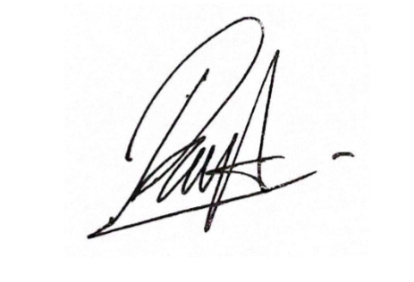
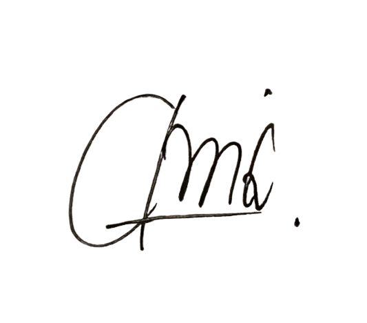
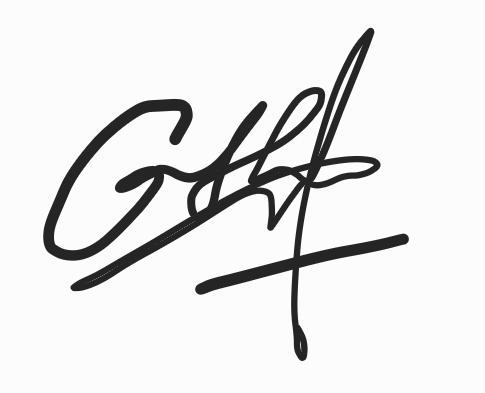

# Deklarasi Penggunaan AI

## Tugas Besar IF2150 - Rekayasa Perangkat Lunak

| Informasi | Keterangan |
|---|---|
| Kelas | K-03 |
| Nomor Kelompok | G-05 |
| Nama Kelompok | HEYSRIUSLAH |
| Nama Perangkat Lunak | LawHub |

**Anggota Kelompok:**

| NIM | Nama |
|---|---|
| 13525057 | Raya Medina Farrelin |
| 13525003 | Cherinette Corsane Khassyah Purceria |
| 13525108 | Khasya Nurul Amini |
| 13525150 | Livy Chandra|
| 13525138 | Cathrine Angel Siburian |

---

### Daftar Isi
* [Milestone 1](#milestone-1)
* [Milestone 2](#milestone-2)
* [Milestone 3](#milestone-3)
* [Milestone 4](#milestone-4)
* Notes: Copy bagian Daftar Isi seperti Milestone 1 untuk Milestone berikutnya, contoh ``* [Milestone 2](#milestone-2)``. Ketika Daftar isi diklik maka akan langsung diarahkan ke bagian bawah sesuai dengan Milestone tujuan.

---

### Log Penggunaan AI per Milestone

Silakan catat penggunaan AI yang berdampak signifikan pada pengerjaan tugas (misal: *generate* fungsi algoritma yang kompleks, *generate* draf dokumen SKPL/DPPL, atau *debugging* error utama). 
*Penggunaan sepele seperti memperbaiki *typo* atau auto-complete satu baris kode tidak perlu dicatat.*

### Milestone 1
| Tool AI | Tujuan Penggunaan | Contoh Prompt Utama | Modifikasi & Validasi Manusia |
| :--- | :--- | :--- | :--- |
| *[Nama AI]* | *[Sertakan Tujuan Penggunaan]* | *[Tuliskan Prompt Utama]* | *[Tuliskan Keputusan Hasil Validasi]* |
| *Google Translate* | *Menerjemahkan laman berbahasa lain* | *-* | *AI menerjemahkan kalimat dan diverifikasi kembali kesesuainnya* |

### Milestone 2
| Tool AI | Tujuan Penggunaan | Contoh Prompt Utama | Modifikasi & Validasi Manusia |
| :--- | :--- | :--- | :--- |
| | | | | |

### Milestone 3
| Tool AI | Tujuan Penggunaan | Contoh Prompt Utama | Modifikasi & Validasi Manusia |
| :--- | :--- | :--- | :--- |
| | | | | |

### Milestone 4
| Tool AI | Tujuan Penggunaan | Contoh Prompt Utama | Modifikasi & Validasi Manusia |
| :--- | :--- | :--- | :--- |
| Gemini | Mengonfirmasi hubungan antar kelas pada diagram UC 15 - 20 sudah sesuai | Pada Use case berikut [menyertakan deskripsi use case secara singkat] apakah hubungan antar kelas berikut sudah sesuai [menyertakan foto diagram kelas yang telah dibuat] | - |

### Milestone 5
| Tool AI | Tujuan Penggunaan | Contoh Prompt Utama | Modifikasi & Validasi Manusia |
| :--- | :--- | :--- | :--- |
| Gemini | Menggabungkan atribut antar kelas | Isilah tabel berikut dalam tipe file markdown sebagai gabungan dari tabel-tabel berikut | - |
| Gemini | Menulis Logbook | Menulis Logbook berdasarkan kegiatan dan commit tiap anggota | - |

### Milestone 6
| Tool AI | Tujuan Penggunaan | Contoh Prompt Utama | Modifikasi & Validasi Manusia |
| :--- | :--- | :--- | :--- |
| Gemini | Mengevaluasi kecocokan pola arsitektur MVC (*Model-View-Controller*) untuk platform LawHub (HaloLaw & SearchLaw), merumuskan pembagian tanggung jawab komponen View, Controller, Model, serta integrasi eksternal (`PaymentGatewayAdapter`), dan menyusun narasi *Logical View*. | "Bantu analisis kelebihan dan keterbatasan pola arsitektur MVC untuk aplikasi konsultasi hukum real-time (HaloLaw) dan pencarian dasar hukum (SearchLaw), serta susun identifikasi komponen View, Controller, Model, dan integrasi eksternal." | Tim memvalidasi batasan tanggung jawab tiap komponen agar selaras dengan SKPL, menyesuaikan penamaan komponen (misalnya mengganti `LiveChatMasyarakatView` menjadi `LiveChatView`), serta membuat diagram *Logical View* secara manual untuk memastikan alur tiga aktor (Masyarakat, Mitra Pengacara, Admin) akurat. |

### Milestone 7
| Tool AI | Tujuan Penggunaan | Contoh Prompt Utama | Modifikasi & Validasi Manusia |
| :--- | :--- | :--- | :--- |
| Gemini | Membantu pemetaan kelas analisis ke kelas perancangan (`C01`–`C51`), menyusun draf alur pemanggilan metode (*Sequence Diagram*) untuk skenario normal dan alternatif pada `UC01`–`UC22`, serta mengecek konsistensi atribut dan operasi pada Diagram Kelas Keseluruhan. | "Berdasarkan skenario normal dan alternatif UC10–UC12 pada SKPL LawHub, susun urutan pemanggilan metode antara View, PenjadwalanKonsultasiController, SesiKonsultasiController, dan model SesiKonsultasi untuk sequence diagram." | Anggota kelompok memverifikasi ulang setiap pesan, blok percabangan *alt/opt*, serta tipe parameter dan nilai kembalian agar konsisten antara *Sequence Diagram* dan *Class Diagram*, merapikan penomoran ID kelas, dan menggambar seluruh diagram secara manual. |

### Milestone 8
| Tool AI | Tujuan Penggunaan | Contoh Prompt Utama | Modifikasi & Validasi Manusia |
| :--- | :--- | :--- | :--- |
| Gemini | Menyusun draf notasi algoritmik (`Algo-XXX`) untuk operasi kelas perancangan, merumuskan spesifikasi query SQL (`Q-XXX`), serta menyusun tabel spesifikasi objek antarmuka (`O-01` s.d. `O-216`) dari *wireframe* Figma `UI-01` hingga `UI-32`. | "Buatkan tabel spesifikasi objek antarmuka (Id_Objek, Jenis, Konten, Keterangan) untuk layar UI-08 (Pemilihan Jadwal Konsultasi) dan UI-29 (Konfirmasi Konsultasi) berdasarkan elemen desain di Figma, beserta pseudocode algoritmanya." | Tim mencocokkan kembali setiap `Id_Objek` dengan komponen visual aktual pada prototipe Figma LawHub, menyesuaikan sintaks query agar kompatibel dengan SQLite pada tahap implementasi, dan memverifikasi tabel Matriks Kerunutan kelas perancangan terhadap seluruh Use Case. |

### Milestone 9
| Tool AI | Tujuan Penggunaan | Contoh Prompt Utama | Modifikasi & Validasi Manusia |
| :--- | :--- | :--- | :--- |
| Claude | Membantu pembuatan kode awal (*scaffolding* dan implementasi fitur) modul Konsultasi (`UC10`, `UC11`, `UC12`) pada stack Node.js, Express, EJS, SQLite (`better-sqlite3`), dan Socket.IO, mencakup `SesiKonsultasi.js` (transaksi jadwal, konfirmasi mitra, enkripsi pesan AES-256-GCM, dan auto-cancel/auto-close sesi *idle*), kontroler (`PenjadwalanKonsultasiController.js`, `SesiKonsultasiController.js`), `src/socket/konsultasi.js`, serta antarmuka EJS dan skrip *client-side*. | "Implementasikan UC10, UC11, dan UC12 untuk modul konsultasi LawHub menggunakan Express.js, EJS, better-sqlite3, dan Socket.IO (namespace /konsultasi) mengacu pada kelas C12–C14, C31–C32, dan C46 di DPPL, lengkap dengan validasi bentrok slot jadwal dan timer timeout." | Kode hasil generasi diuji secara lokal menggunakan data uji (`npm run db:seed-konsultasi`), disesuaikan skema kolomnya dengan tabel SQLite `lawhub.db` anggota tim lain, diperbaiki tampilan CSS dan sanitasi XSS pada *bubble chat*, serta direview oleh rekan tim melalui Pull Request sebelum digabungkan ke branch `develop`. |
| Claude | Membantu menyusun dokumentasi *Issue* dan *Pull Request* berbasis keterlacakan SKPL–DPPL–Kode untuk `UC10`–`UC12`, membantu *troubleshooting* alur Git (`git revert` dan `git cherry-pick` untuk membuat PR fitur tanpa menghapus *commit* anggota lain di `develop`), serta menyusun laporan implementasi Bagian B dan formulir penggunaan AI. | "Susun dokumentasi Markdown untuk UC10, UC11, dan UC12 yang memetakan ID Use Case, kelas perancangan DPPL, kebutuhan fungsional/non-fungsional, kriteria penerimaan, dan file implementasi aktual pada repositori IF2150-RPL-K03-G05." | Seluruh path file, nama fungsi/route, pembagian PIC dan Reviewer, serta perintah Git diverifikasi langsung terhadap struktur repositori `rmdifmedia/IF2150-RPL-K03-G05` sebelum disimpan ke folder `docs/`. |

---
### Pernyataan Integritas dan Persetujuan

Kami yang bertanda tangan di bawah ini menyatakan bahwa seluruh log penggunaan AI di atas adalah benar. Kami telah memvalidasi seluruh hasil AI dan bertanggung jawab penuh atas orisinalitas, keamanan, dan kebenaran hasil akhir dari tugas ini.

| Tanda Tangan | Nama Anggota |
| :---: | :--- |
|  | **13525057 - Raya Medina Farrelin** |
|  | **13525003 - Cherinette Corsane Khassyah Purceria** |
|  | **13525150 - Livy Chandra** |
|  | **13525138 - Cathrine Angel Siburian** |
|  | **13525108 - Khasya Nurul Amini** |
