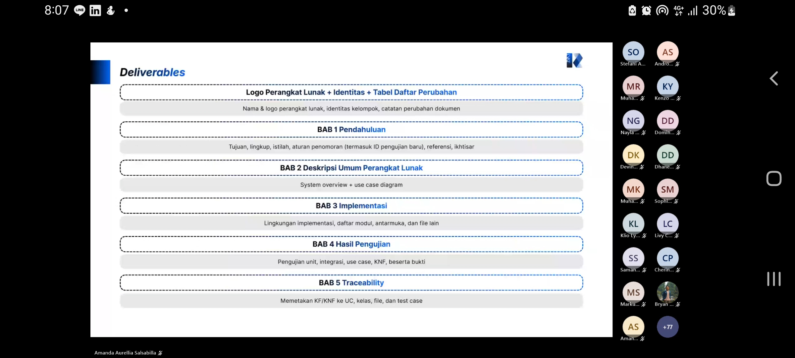

# Form Asistensi

## Tugas Besar IF2150 - Rekayasa Perangkat Lunak

| Informasi | Keterangan |
| --- | --- |
| **Hari** | Senin |
| **Tanggal** | 16/11/2026 |
| **Kelas** | 03 |
| **Nomor Kelompok** | 05  |
| **Nama Kelompok** | HEYSRIUSLAH  |
| **Nama Perangkat Lunak** | LawHub  |
| **Dokumen** | HIUPL |

### Anggota Kelompok

| NIM | Nama |
| --- | --- |
| 13525003 | Cherinette Corsane Khassyah Purceria |
| 13525057 | Raya Medina Farrelin |
| 13525108 | Khasya Nurul Amini |
| 13525138 | Cathrine Angel Siburian |
| 13525150 | Livy Chandra |

### Catatan

| Catatan |
| --- |
| 1. perhatiin penomorannya biar traceabilitynya jelas |
| 2. referensi minimal ada SKPL, DPPL, dan implementasi |
| 3. testing itu dilakukan supaya bisa verifikasi apakah sistem itu secara keseluruhan sudah memenuhi kriteria yang penerimaan yang dilakukan |
| 4. Jenis pengujian fusional sendiri itu juga banyak. Ada white box test black box testing, ad hocting IPI testing, eksportir testing, smoketing, dan juga user acceptance testing. |
| 5. Untuk non functional testing itu tuh lebih berfokus pada kualitas sistem ketika sistem tersebut dijalankan. Misalnya ketika pengguna ngelakuin login apakah si sistem itu bisa kasih respon dengan cepat gitu. Apakah sistemnya aman ketika si pengguna tuh input password nya kayak gimana si password itu bisa disimpan. |

## Dokumentasi

<!--  -->

  

  <i>Gambar 1. Dokumentasi kegiatan asistensi.</i>

